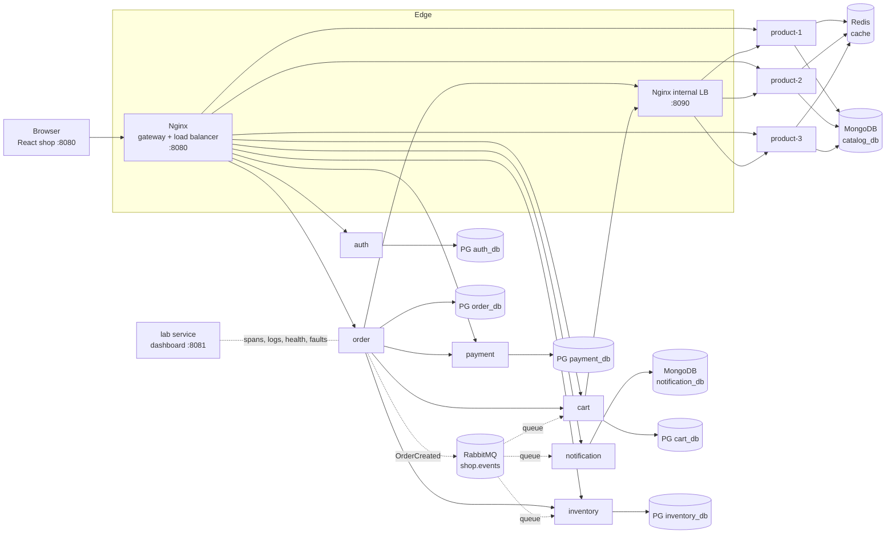
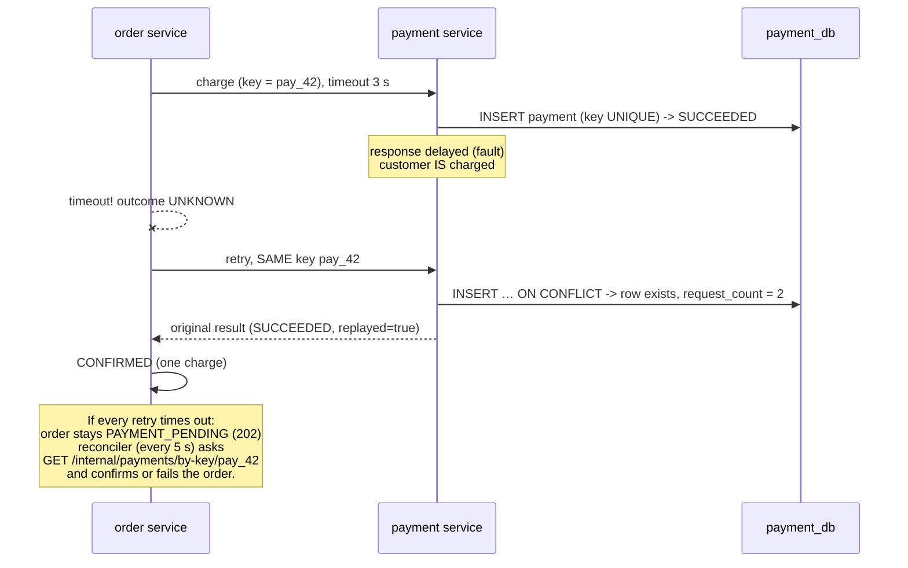
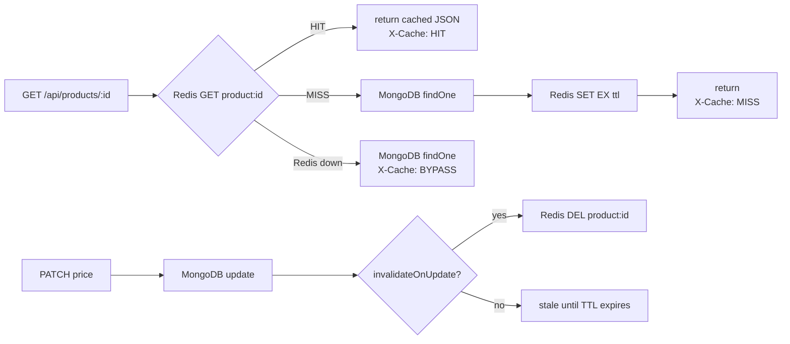

# QAMart Architecture

QAMart is a deliberately small but **real** distributed system. Every box below is a running container; every arrow is a real network call, SQL statement, cache lookup or message.

## 1. System diagram



Solid arrows are synchronous HTTP. Dotted arrows are asynchronous messages. The lab service only *observes and controls* the system. It isn't part of the shop.

## 2. Components and responsibilities

| Component | Tech | Owns | Responsibilities |
|---|---|---|---|
| **Nginx (edge :8080)** | nginx 1.27 | – | Serves the React shop and API docs. Acts as the **API gateway** (routes `/api/<area>` to the owning service) and the **load balancer** (round robin over `product-1..3`, failover on errors/timeouts). Generates `X-Request-ID`. |
| **Nginx (internal LB :8090)** | nginx | – | Load-balances **service-to-service** calls to the product instances. Not published to the host. |
| **auth** | Node/TS, Express | `auth_db.users` | Login, JWT issuing, `/me`. |
| **product ×3** | Node/TS | `catalog_db.products` (MongoDB), Redis cache | Search, product details (cache-aside), admin price updates and cache invalidation. Stateless, so it can run as many identical instances. |
| **cart** | Node/TS | `cart_db.cart_items` | Cart CRUD; snapshots name/price from the product service; empties itself on `OrderCreated`. |
| **inventory** | Node/TS | `inventory_db.stock, reservations` | Stock levels, all-or-nothing reservations inside SQL transactions, commit on `OrderCreated`, release on failure. |
| **order** | Node/TS | `order_db.orders, order_items, order_events, coupons, coupon_redemptions, outbox` | **Checkout orchestrator**: idempotency, re-pricing, coupons, stock reservation, payment with safe retries, reconciliation, event publishing (outbox). |
| **payment** | Node/TS | `payment_db.payments` | A simulated payment provider. The idempotency key is UNIQUE in the database. Success, decline and slow modes. |
| **notification** | Node/TS | `notification_db.notifications` | Consumes `OrderCreated` and stores the "sent" confirmation e-mail. Retries, DLQ, and idempotent processing. |
| **PostgreSQL 16** | – | 5 databases | Relational, transactional data. One login role per service. |
| **MongoDB 7** | – | 2 databases | Flexible product documents; notification documents. |
| **Redis 7** | – | – | Cache for product details (TTL, invalidation). |
| **RabbitMQ 3.13** | – | – | Topic exchange `shop.events`, one queue per consumer, plus `.retry` and `.dlq` queues for each. |
| **lab** (teaching only) | Node/TS | in-memory telemetry | Receives spans and logs, tails Nginx access logs, polls health, injects faults, stops/starts containers, runs demos, resets data. **Refuses to start unless `LAB_MODE=true`.** |

## 3. Data ownership

Each service is the **only** writer and reader of its database. It connects with its own database user, and Postgres `REVOKE CONNECT … FROM PUBLIC` makes that a rule the database enforces, not just a convention:

```
auth_svc      -> auth_db         catalog_svc      -> catalog_db
cart_svc      -> cart_db         notification_svc -> notification_db
inventory_svc -> inventory_db
order_svc     -> order_db
payment_svc   -> payment_db      lab_readonly     -> SELECT on everything (teaching only)
```

If a service needs another service's data, it **asks through an API** (order → cart, cart → product) or **reacts to an event** (inventory and cart react to `OrderCreated`). Nobody joins across service databases.

*Trade-off:* one Postgres server keeps the laptop footprint small. In production each service would usually get its own database instance, which you can scale and fail independently.

### Why SQL here and NoSQL there?

| Data | Store | Why |
|---|---|---|
| Orders, payments, stock, coupons, carts, users | PostgreSQL | Fixed structure, foreign keys, CHECK constraints (`available >= 0`), multi-row **transactions** (order + items + coupon + outbox commit together or not at all), row locks for concurrent stock updates. |
| Product catalog | MongoDB | Every category has different attributes (`specs` for phones, `variants.size` for kurtas). Documents are read whole and rarely joined. |
| Notifications | MongoDB | Append-mostly documents whose content can evolve. A unique index on `eventId` gives idempotency. |

Neither choice is "better": MongoDB supports transactions and unique indexes too, and Postgres scales well. The point is to **fit the store to the access pattern**.

## 4. Communication patterns

### Synchronous (request/response)
Browser → Nginx → service, and order → cart / product / inventory / payment. The caller waits, so it is **coupled to the callee's availability and latency**. Every outbound call has a timeout, and each failure is classified as one of:

* `unavailable`: the request never arrived, so the outcome is known and it's safe to fail fast.
* `timeout`: **the outcome is unknown.** The callee may have done the work.
* `http`: the callee answered with an error status.

### Asynchronous (events)
When an order is confirmed, the order service writes an `OrderCreated` row to its **outbox table in the same transaction**. A publisher loop sends unpublished rows to RabbitMQ (with publisher confirms) and marks them published. Three queues each get a copy:

| Queue | Consumer | Effect | Idempotent because… |
|---|---|---|---|
| `notification.order-created` | notification | store e-mail | unique `eventId` |
| `inventory.order-created` | inventory | reservation HELD → COMMITTED | state check (already committed means no-op) |
| `cart.order-created` | cart | delete purchased lines | deleting twice deletes nothing |

Failed messages are rejected into `<queue>.retry` (TTL 5 s), which dead-letters back into the main queue. After 3 attempts the consumer moves the message to `<queue>.dlq`.

### Correlation and tracing
Nginx generates `X-Request-ID`, or keeps a well-formed one from the caller. Every service:

1. reads it and stores it in an `AsyncLocalStorage` context,
2. adds it to every log line, every outbound HTTP call (`X-Request-ID`, `X-Parent-Span-Id`) and every RabbitMQ message header,
3. records spans (HTTP server/client, SQL, Mongo, Redis, publish, consume) and ships them to the lab service.

Nginx's JSON access log (which instance served the request, upstream retries, timing) is tailed by the lab service and joined to the same trace. Nothing in the dashboard is simulated.

*Trade-off:* a ~150-line custom tracer instead of OpenTelemetry + Jaeger. It's easy to read in class but not standards-based. Moving to OpenTelemetry is a good extension exercise.

## 5. Key flows

### 5.1 Checkout (synchronous orchestration + asynchronous follow-up)

```mermaid
sequenceDiagram
    autonumber
    participant B as Browser
    participant N as Nginx
    participant O as order
    participant C as cart
    participant P as product (via internal LB)
    participant I as inventory
    participant Pay as payment
    participant Q as RabbitMQ
    B->>N: POST /api/orders (Idempotency-Key: K)
    N->>O: route + X-Request-ID
    O->>O: SELECT order WHERE key=K (replay?)
    O->>C: GET /internal/carts/{user}
    O->>P: GET /internal/products?ids=… (DB, not cache)
    O->>O: BEGIN; INSERT order, items; redeem coupon; COMMIT
    O->>I: POST /internal/reservations
    I->>I: BEGIN; UPDATE stock … WHERE available >= qty; COMMIT
    O->>Pay: POST /internal/payments (key pay_{orderId}, timeout 3s)
    Pay-->>O: SUCCEEDED
    O->>O: BEGIN; status=CONFIRMED; INSERT outbox(OrderCreated); COMMIT
    O-->>B: 201 Created (order)
    O--)Q: outbox publisher: OrderCreated
    Q--)I: commit reservation
    Q--)C: remove purchased items
    Q--)B: (notification service stores e-mail; shop polls /api/notifications)
```

**Failure handling at each step**

| Step fails | Result | Compensation |
|---|---|---|
| cart / product unreachable | 503 `CART_UNAVAILABLE` / `CATALOG_UNAVAILABLE` | nothing to undo |
| coupon invalid / exhausted | 422 `COUPON_*` | transaction rolled back, no order |
| not enough stock | 409 `OUT_OF_STOCK`, order REJECTED | inventory transaction rolled back |
| payment declined | 402, order PAYMENT_FAILED | release reservation, give coupon back |
| payment unreachable (3 tries) | 503, order PAYMENT_FAILED | release reservation, give coupon back |
| payment **timed out** | 202, order PAYMENT_PENDING | **nothing yet.** The reconciler decides. |

### 5.2 "Charged, but the response timed out"



Three rules make this safe:
1. **Never treat a timeout as "not charged".**
2. **Retry with the same idempotency key**, which the database guarantees to be unique.
3. **Reconcile:** a background job asks the source of truth instead of guessing.

### 5.3 Cache-aside (product details)



Checkout never trusts the cache (or the cart snapshot) for prices. It reads the database through `/internal/products`.

### 5.4 Load balancing and failover

```mermaid
sequenceDiagram
    participant C as Client
    participant N as Nginx (round robin)
    participant P1 as product-1
    participant P2 as product-2 (stopped)
    participant P3 as product-3
    C->>N: GET /api/products
    N->>P2: connect… (timeout 1 s)
    N->>P1: proxy_next_upstream (GET only)
    P1-->>N: 200
    N-->>C: 200 (X-Served-By: product-1)
    Note over N: P2 marked failed for 10 s; DNS re-resolution<br/>(valid=5s) removes it until it restarts
```

POST requests are **not** retried by Nginx (`non_idempotent` isn't enabled). Retrying a checkout belongs in the application, where idempotency keys exist.

## 6. Security boundaries

* Customer APIs: `/api/*` on :8080. JWT checked **in every service**, and the owner is checked on every order, payment and notification read (other users get 404).
* Internal APIs: `/internal/*` are never routed by the edge, and require `X-Internal-Token`. Nginx strips that header from outside requests.
* Teaching APIs: `/__lab/*` exist only when `LAB_MODE=true`, need `X-Lab-Token`, and are never routed by Nginx. The dashboard (:8081) and its backend run only in lab mode. All host ports bind to 127.0.0.1.
* `docker-compose.prod.yml` sets `LAB_MODE=false`, removes the lab service and the :8081 server, and drops diagnostic headers.
* The lab container mounts the Docker socket so it can stop and start containers, which is equivalent to root on the Docker host. It's only acceptable for a local teaching machine, and it uses an allow-list (application services, Redis, RabbitMQ; never the databases).

## 7. Simplifications (on purpose)

| Simplification | Production would… |
|---|---|
| One Postgres / Mongo server for all services | separate instances per service |
| Single instance of order/payment/notification | multiple instances; outbox publisher with `FOR UPDATE SKIP LOCKED` or leader election |
| Faults held in memory per instance | feature-flag service or chaos tooling |
| Custom tracer, in-memory trace store | OpenTelemetry + Jaeger/Tempo, Prometheus, Grafana |
| HS256 JWT with shared secret | asymmetric keys (RS256/JWKS), token refresh |
| Passive health checks in Nginx | active health checks / service mesh |
| Simulated payment provider | real PSP with signed webhooks for reconciliation |
